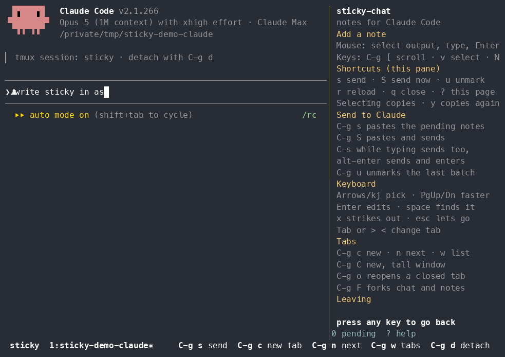

# Sticky-Chat

[](#another-agent)
[](https://pypi.org/project/sticky-chat/)
[](https://www.python.org/downloads/)
[](https://github.com/tmux/tmux)
[](https://github.com/hrhodin/sticky-chat/actions/workflows/ci.yml)
[](LICENSE)

Keep your thoughts linked: Attach sticky notes to chat output, then hand the quoted
text plus your notes back to the agent in one paste.



Select any part of the output with the cursor: a few characters, a line, or
a block of lines. Then type a short note. The note is logged in a sidebar pane,
aligned with the output row it belongs to.
You then decide when to send the batch of pending notes to the agent's prompt, continuing the discussion in a single thread, or to fork into a new tab window.

It is a few thousand lines of Python with no dependencies, driving the tmux
you already have. Sticky sends nothing to the outside and neither the agent nor tmux is patched or replaced: 
sticky-chat runs on its own local socket (`tmux -L sticky`) with a config it
generates into `~/.sticky/tmux.conf`, so your sessions and key bindings
keep working alongside it.

Start it with `sticky-chat` (or shorthands `sticky claude`)  and possible arguments you would otherwise give to the agent.

## Requirements

- **tmux 3.7 or newer** (`tmux -V`). 3.7 is where floating panes arrived,
  which is what the note prompt is, and it also brings redraws inside a synchronized
  update, so the sidebar never tears. Until `pane-activity` reaches a tmux
  release, the sidebar checks the pane twice a second rather than being woken
  when the agent prints — cheap, but not free.
- **Python 3.9 or newer**. The program itself uses only the standard
  library, so it pulls in nothing else.
- **An agent.** Claude Code on your `PATH` as `claude` is the default;
  Gemini CLI and Codex CLI have profiles of their own, and `--agent-cmd`
  runs anything else that prints a transcript.
- macOS or Linux; Windows only inside WSL. No admin rights are needed.
- **docker or podman**, only if you want a tab to run the agent inside a
  container — see [keeping the agent inside a
  fence](#keeping-the-agent-inside-a-fence). Either will do and they are
  offered side by side. Without one, tabs open as they always did and the
  prompt says why.

If tmux is missing: `brew install tmux` on macOS, `apt install tmux` or
`dnf install tmux` on Linux. Copying to the system clipboard uses `pbcopy`,
`wl-copy`, `xclip` or `xsel`, whichever is present; without one the copy
keys fill tmux's own paste buffer instead.

## Install

```sh
uv tool install sticky-chat      # or: pipx install sticky-chat
pip install sticky-chat          # works too; see below
```

That puts `sticky-chat` on your `PATH`, and `sticky` as a shorter name
for the same command.

There are no dependencies to resolve - the program is standard library
only - so `pip` is as good as the others at fetching it. What the first two
add is a virtualenv of their own: a command-line tool installed with `pip`
lands in whichever environment happens to be active, which is a nuisance
when that environment changes or goes away, and on a system Python it is
refused outright.

If you would rather run the source you can inspect and edit:

```sh
git clone https://github.com/hrhodin/sticky-chat ~/Code/sticky-chat
mkdir -p ~/.local/bin
ln -s ~/Code/sticky-chat/bin/sticky-chat ~/.local/bin/sticky-chat
ln -s ~/Code/sticky-chat/bin/sticky      ~/.local/bin/sticky
```

`bin/sticky-chat` runs the checkout directly, so `git pull` is all an
update takes. If `~/.local/bin` is not on your `PATH` yet:

```sh
echo 'export PATH="$HOME/.local/bin:$PATH"' >> ~/.zshrc   # or ~/.bashrc
```

Check it with `sticky-chat --version`. To uninstall, remove the command
and `~/.sticky`, which holds the generated config and your notes.

## Quick start

```sh
sticky-chat start ~/my-project
```

That opens one tmux window: the chat pane on the left, the notes sidebar
on the right, 34 columns wide. Drag over something the agent printed, type
a note, press `C-g s` to send every pending note back to the agent.

```sh
sticky-chat start ~/my-project -- --dangerously-skip-permissions
sticky-chat new ~/other-project    # a second tab, a second project
sticky-chat                        # re-attach later
```

Arguments after `--` reach the agent unchanged, so `--continue` and
`--resume` work through `sticky-chat start`. Notes belong to the conversation, not to
the directory: a second tab on the same project opens an empty sidebar, and
resuming a tab brings its own notes back. `C-g z` zooms the chat pane to
full width; the sidebar keeps running behind it.

`C-g c` asks for the project in a prompt, starting from the directory the
pane is in. **Tab** completes directory names - once if there is only one,
listing the choices if there are several - and a path that does not exist
is said so with what you typed still on the line to correct. Esc cancels.

### Another agent

```sh
sticky claude ~/my-project         # the same as sticky-chat start, shorter
sticky gemini ~/my-project         # Gemini CLI instead
sticky codex  ~/my-project         # Codex CLI instead
sticky agy    ~/my-project         # Google's Antigravity CLI
sticky shell  ~/my-project         # no agent at all, just a shell
sticky-chat start ~/p --agent generic --agent-cmd aider   # anything else
```

An agent's name in that position picks its profile, unless a directory of
that name is sitting there, which wins. `shell` is the one that is not an
agent: a tab with a shell in it, for reading a log or a test run or a diff.
Notes are taken there the same way, and then go to whichever tab should
see them - press its number in the sidebar, the one tmux shows in the
status line.

An agent that runs out of turns says so and stops. Sticky reads the time it
gave, waits until then plus a few minutes, and sends one word - `continue` -
so a night's work is not lost to a limit that lifted at half past midnight.
Three attempts at most: if three have not got past it, something is wrong
that waiting will not fix. Ask the tab something yourself and the three
start over - a tab that ran out last night should not spend the rest of
its life one strike from the end. The tab shows `⧗` while it waits, the
sidebar says `⧗ sending "continue" in 40 min` on a row of its own with the
hour in the footer beneath it. Click that row to call it off - it stays
there struck out, so you can see what it was going to do and click again to
put it back - or `t` then `cancel` to be rid of it.

Where the agent keeps a transcript, that is what is read rather than the
screen. A notice is a record of its own in there - Claude Code writes
`{"type":"system","level":"notice","content":"Usage limit reached ..."}` -
while a paragraph *about* limits is a message, and no reading of a screen
can tell those two apart: the words are the same, which is how a tab came
to type `continue` at a conversation that was waiting for nothing. Claude
Code also now says `continuing automatically at 4am` and does exactly that,
so where the notice says the agent will carry on by itself, sticky stands
down rather than poking a conversation that is already coming back. An
agent that writes nothing readable - Codex prints its notice and keeps no
transcript we can find - is still read off the screen, by the words and a
clock after them. To have none of it:

```sh
# ~/.sticky/user.conf
set -g @sticky_continue off
```

That takes hold at the next notice, without a reload.

### The lit lines while you read back

Scrolling back in an agent pane lights the rows you have notes on, using
tmux's own search highlighting. That search costs tmux the whole history and
marks every match in it, so it is kept on a leash: only quotes that actually
appear in the last couple of thousand rows are looked for — notes from an
hour ago are not on the screens you are reading, and searching for something
absent is the most expensive search there is — and only as many of them as
the history can afford, newest and still-pending first. A tab that has
printed a couple of hundred thousand lines is left unlit altogether, because
lighting it would cost most of a second with the tmux server blocked, and
every pane in the session draws through that server. The notes are all in
the sidebar either way.

`set -g @sticky_marks off` in `~/.sticky/user.conf` turns the lighting off
entirely.

### Stopping what a tab is running

`C-g k` stops everything the tab started and nothing the tab is: the test
run, the build, the dev server that will not come back. The pane's own
process stays, so an agent keeps its conversation and a shell keeps its
history — for the tab itself there is tmux's own `prefix &`. It asks before
it acts, and `sticky-chat kill --list` says what it would stop without
stopping anything.

It exists because Ctrl-C does not always arrive. A terminal sends the
keystroke to the pane's *foreground process group*, and a runaway three
levels down often sits in a group of its own: a script that spawned a `node`
that drives an app, say, where Ctrl-C reaches the script, the script traps
it, and the thing actually burning the afternoon never hears about it. This
goes by parentage instead — everything descended from the pane's process,
deepest first — and then by terminal, which catches a job whose parent has
exited but which still holds the tty. SIGINT first, then SIGTERM for what
traps it, then SIGKILL; what survives all three is named rather than
retried.

One thing it cannot see: a child that detached from the terminal as well as
from its parent — a `setsid`, a daemon — keeps nothing that says which tab
it came from. `--list` shows what can be traced, and the rest is a `pkill`
of yours.

### Carrying on where the agent stopped

The clock above waits out a limit nobody chose. The other half of the same
wish is an agent that stops because it thinks it has finished, and that one
has to be asked for: an agent which says it is done is usually right, and a
tab that argued with it every time would be unusable.

`C-g a` asks for five more turns, and it stacks — press it twice for ten.
`C-g A` asks for all of them, until you say otherwise, and pressing it again
is how you stop. A count rather than a switch, because the honest version of
"keep going" is "keep going for a while and then let me look"; the switch is
there for the times when you know it is an hour of work and you are going to
bed. The sidebar carries `↺ carrying on, 5 more times` on its own row and
`↺5` in the footer, so a tab that will start the next turn by itself never
looks like one that has stopped.

Each turn the arm starts costs one from the count, and two things spend the
whole of it early, both on purpose. If the agent's window redraws to exactly
what it was, the word achieved nothing. And if the turn stops printing within
a second — which is what an agent that has exited to a shell and is echoing
your word back looks like — the same. Without those, `C-g A` on a dead pane
would type `continue` into it every few seconds until morning. An agent that
genuinely finishes in under a second had nothing left to do either, so the
arm standing down there is the right answer as well.

`sticky-chat auto --add 20`, `--forever` and `--off` say the same from a
shell, and the count lives on the agent's pane — `tmux show-options -p
@sticky_autocontinue` answers what a tab is about to do, a reload keeps it,
and nothing about it is remembered once the tab closes.

A deadline that falls
while the machine is asleep is not lost - the clock is a wall-clock time,
compared on the first pass after the machine wakes, so it fires then rather
than never.

The tab list at the bottom says which agent is in which tab, one character
in front of the name: `✦` Claude Code, `◆` Codex, `✧` Gemini, `▲` Antigravity,
`$` a shell, `•` anything else. The mark is highlighted while a tab is
waiting to be read - it printed something and then went quiet, which is
the only definition of "finished" that holds for every agent - and looking
at the tab clears it.

If a tab marks itself and you cannot see why, `sticky log <file>` records
what each sidebar decided and the rows that changed to make it decide that.
It takes effect at once, needs no reload, and `sticky log --off` stops it.

Tabs with no agent in them - shells, and any window you made in this session
yourself - get a row of their own beneath, labelled `other`. It is there
only while something is on it, so a session of nothing but agent tabs has
the one row it always had.

Nothing else you touch changes with the agent - the same keys, the same
sidebar, the same send. What changes is only what the agent itself can be
asked for:

| agent | reopens the same conversation | `C-g F` forks it |
|---|---|---|
| Claude Code | yes - sticky names the conversation when it starts it | yes |
| Gemini CLI | yes, once sticky has read the id out of its transcript | no, Gemini has no branch command |
| Codex CLI | yes, once sticky has read the id out of its transcript | yes |
| Antigravity CLI (`agy`) | yes, once sticky has read the id off its own file | no, no branch command yet |
| anything else | no; the tab comes back, the conversation starts fresh | no |

## Taking a note

- **Mouse**: drag across any output in the left pane. Releasing opens a
  prompt; type the note and press Enter.
- **Keyboard**: scroll up with the wheel or `C-g [`, press `v` to start a
  selection, move, then press `N`.
- **Shell**: `echo "some text" | sticky-chat add --note "why is this here"`

Scrolled back, the status line counts what has arrived while you were
reading — `↓ 37 new output rows below`, highlighted, clearing when you
return to the bottom.

Scrolled back, any ordinary key gets you out again: typing a letter leaves
the scroll and the letter arrives at the agent, which is what pressing it
meant.

In the prompt, **Enter** saves and **Ctrl-U** clears the line. **Ctrl-S** or **Alt-Enter** saves the note
and sends the whole batch to the agent without going via the sidebar; press
Enter in the chat pane as you would after `C-g s`. **Ctrl-C** — or ⌘C, with
the terminal set up as [below](#command-c-on-a-mac) — copies the selected text to the system clipboard and
closes without making a note. **Esc** on an empty note cancels it; Esc
after typing keeps what you wrote, struck through in the sidebar — click
its `x` to bring it back. Esc or Ctrl-C while editing an existing note
leaves it as it was.

**Clicking anywhere else** finishes the note too: what you had typed is
saved, and an untouched prompt is taken back rather than left as a blank
row.

## Sending notes

Saving a note hands you to the sidebar, so `s` sends it and `S` sends it
without waiting — the keys are under your fingers already. Sending pastes
every pending note into the agent's prompt as one block, leaves copy mode if
you were reading back, and puts you at the agent's prompt where the answer is
about to appear, so Enter is the next key. From the chat pane the same two are `C-g s` and
`C-g S`. A single-line quote becomes

```
cannot find module - is this the vendored copy or the npm one?
```

and a multi-line quote becomes

```
> error: cannot find module
>     at line 42
- which of these two fails first?
```

Notes go out in the order they appear in the pane, separated by blank
lines; struck-out notes and notes with no text are left out. Sent notes
stay in the sidebar, grey and marked `✓`, so you can see what you have
already asked about.

If the paste never made it — you cleared the prompt instead of pressing
Enter — press `C-g u`, or `u` in the sidebar, to put the last batch back to
pending. Sending never deletes anything; it only changes status.
`sticky-chat commit --send` presses Enter for you.

## Keys

The prefix is `C-g`. Your own
tmux keeps whatever prefix you configured.

| key | what it does |
|---|---|
| `C-g s` | paste every pending note into the prompt; you press Enter |
| `C-g S` | the same, and press Enter for you |
| `C-g u` | unmark the last batch: pending again, not taken back (`C-g U`) |
| `C-g c` | new tab: asks for the project, then which agent (`C-g t`) |
| `C-g C` | the same, but the tab gets a window taller than the terminal |
| `C-g F` | fork this conversation into a new tab |
| `C-g o` | reopen a closed tab: lists what is remembered, a number picks |
| `C-g B` `C-g b` | box this tab in a container, or take it back out |
| `C-g a` `C-g A` | carry on for five more turns (stacks), or until told otherwise |
| `C-g k` | stop what the tab is running — not the tab |
| `y`, `M-c` in copy mode | copy the selection; ⌘C sends `M-c` with one line of terminal config |
| `C-g 1`-`C-g 9` in the sidebar | send the pending notes to that tab instead of this one |
| `C-g r` | reload: rewrite the config, restart the sidebars (`C-g R`) |
| `C-g L` | print the pending notes into the pane |
| `C-g n` `C-g w` | next tab, choose a tab |
| `C-g z` `C-g d` | zoom the pane, detach (stop looking; nothing stops) |
| `C-g Q` | quit: close every window and stop the agent sessions |
| `C-g [` | scroll back through the output |
| `alt`-drag | let the drag through to a program that wants the mouse itself |

Over the chat pane, drag with the mouse to note a selection, or press `N`
in copy mode. **Selecting copies**, in either pane and whether or not the
selection becomes a note, the way it does in an X11 terminal. `y` in copy
mode copies the live selection again, wherever you are, and leaves it
highlighted, and Ctrl-C in the note prompt copies and closes without
saving anything.

**Middle-click pastes** the last selection, the way it does in an X11
terminal: mark something, middle-click, it appears at the prompt. Under tmux
the mark belongs to tmux rather than to your terminal, so there is no X11
PRIMARY selection involved — what middle-click pastes is tmux's own buffer,
which is what every selection here fills. It works the same on macOS, where
there is no PRIMARY at all. A pane that draws its own screen still gets the
click, since an agent with mouse reporting on has its own idea about button
two, and the sidebar is never pasted into, because it reads every character
as a command. (Selecting in another application and middle-clicking here
needs the real PRIMARY selection, which sticky does not read — the buffer is
tmux's own.)

In the sidebar, any character it has no use for is forwarded to the chat
pane, so you can start typing with your eye still on the notes — and digits
are among them. `C-g 1`-`9` is what hands the pending batch to another tab;
a bare digit types. It used to be the bare digit that sent, which is a trap:
type a message with a `2` in it while the sidebar has focus and the batch
goes into another conversation, silently and with nothing asked. Outside the
sidebar `C-g <digit>` still selects that window, the way tmux has always
done.

### Command-C on a Mac

Command is not a modifier tmux can ever see: macOS terminals consume it and
turn it into an action of their own, so ⌘C copies the *terminal's*
selection — and under tmux there is no terminal selection, because the drag
belonged to tmux. What a terminal can do is send something instead, and
sticky binds what it sends. One line of terminal config:

```sh
# Ghostty: ~/Library/Application Support/com.mitchellh.ghostty/config
keybind = cmd+c=text:\x1bc
```

In iTerm2 the same thing is Settings → Keys → Key Bindings, ⌘C → *Send
Escape Sequence*, with `c` as the sequence. Terminal.app cannot remap ⌘C at
all, so there `y` and the copy-on-selection are what you have.

That sends Esc-c, which arrives as `M-c`, and sticky binds `M-c` to copy
wherever a selection can be copied: the live selection in copy mode, and
the quote in the note prompt, where it does what Ctrl-C does there. Outside
those it is handed to the agent untouched, so taking the key costs nothing.
The trade-off is the one you are asking for: ⌘C stops copying the
terminal's own selection, which under tmux there never is.

An agent can ask for the mouse. Claude Code does while it draws its
multi-agent view — the one with `← for agents` in the footer and things
you click — on the alternate screen, so that those things *are* clickable.
Dragging over that pane is the one gesture this whole program is about, so
sticky keeps it: a drag still marks, whatever the agent asked for. Only the
drag, though — a **click** is still the agent's, so what it drew to be
clicked stays clickable, and **alt**-drag lets a drag through untouched,
for a program with its own scrollbars or its own selection. That last one is
not about agents: it applies wherever something has asked for the mouse.

tmux's own pane gestures — `ctrl`-drag to pull a new pane out where you
drag, `alt`-drag to move one about — are not offered inside a sticky window.
It is an agent and its sidebar, and there is nowhere in that for a third
pane to go: a stray one lands as a floating box drawn over the agent, three
columns wide and impossible to account for. In any other pane both gestures
are tmux's own, untouched.

It is a mode of the agent's rather than a setting of sticky's, so it goes
when you leave that view. Two things behave differently while it is up, both
the agent's doing. The wheel scrolls what the agent draws rather than
entering copy mode — and if you were already in copy mode when the agent
took the screen, the wheel leaves the mode and goes back to it, since an
alternate screen has no scrollback to scroll and the view you were reaching
for is the agent's. And notes above what is on screen stay in the band until
the pane comes back to the normal buffer; the footer's `↑ N above` is
counting them.

Scrolled back, the lines you have already annotated are lit. Copy mode is
the one place tmux will paint over a pane's own output — it colours the
matches of a search — so entering it sets the search to what your newest
notes quote. Quiet on purpose: it is there to be recognised out of the
corner of an eye rather than read. Only the eight most recent, and only
their first forty characters, because that search runs inside the tmux
server and every pane waits while it does.

A search also *moves*, which is not what entering copy mode meant, so both
halves of where you were are put back afterwards: the view and the cursor
inside it. And while a selection is being made, nothing is painted at all —
a cursor that jumps with an anchor down takes everything between the two
with it, which is how reaching for three words got you the afternoon. To
have none of it, `set -g @sticky_marks off` in `~/.sticky/user.conf`.

Inside the sidebar the letters work on their own, without the prefix:

| key | what it does |
|---|---|
| `s` `u` `F` | send, unmark, fork — as above |
| `t` | send later: asks when, filled in with the reset time the agent printed; `cancel` calls one off |
| `↑` `↓` or `k` `j` | move the cursor from note to note |
| `PgUp` `PgDn` `Home` `End` | a screenful, the first note, the last |
| `Enter` | edit the note under the cursor |
| `space` | scroll the chat pane to the text that note came from |
| `x` | strike the note out; again brings it back — the cursored note's `[x]` is drawn bold |
| `Esc` `g` `G` | drop the cursor, back to the live map |
| `Tab` `>` `<` | next tab, next tab, previous tab |
| wheel | page back through every note in this conversation |
| click `sticky` | bottom left of the status line: cross to the sidebar, and click again to cross back |
| `r` | re-read the notes file |
| `?` or `h` | the help panel; any key goes back |
| `q` | close the sidebar |
| any other letter | goes to the chat pane, which takes the focus with it — start typing a message with your eye on the notes |

The list scrolls to follow the cursor; the wheel pans it freely and the
next arrow key snaps the cursor back. Striking out is reversible, and
`sticky-chat rm <id>` is the only thing that deletes a note.

With the mouse: **single click** a note and the chat pane scrolls to the
text it came from, centered, unless it is already on screen. **Double
click** to edit it — the prompt starts from its current text, and changing a
note that was already sent puts it back to pending. Clicking the `[x]` at
its right edge strikes it out; clicking again brings it back. Dragging inside
the sidebar selects text and leaves the selection standing until `Esc` or
`q`.

## The sidebar

The lower part is a map of the chat pane: each note sits on the row its
text is on, with a marker spanning the rows it covers, and reads
`- your note` under a dimmed copy of the quoted line, or `✓ your note` once
sent. Yellow means pending, grey means sent, orange means the text has
changed enough that the position shown is a guess.

Above that, over a rule, is a dense list of the notes *above* what you can
see — whatever has scrolled off the top, nearest one at the bottom. It says `↑ N more` on its top row
when the list is truncated.

A note whose row belongs to a pane that has gone — anything taken before a
resume — cannot be compared with this screen at all, so those are listed
above everything that does have a row here, ordered by the pane they were
taken in and then by their row in it. Within one pane that row is still
exact, which matters because going back to annotate something further up
makes a later note that belongs earlier. Across panes there is nothing to
compare but the clock, so the panes go in the order they began — and a note
old enough that no pane was recorded for it has no position at all, so it
goes by its clock too.

There is one list and it is above, whatever the reason a note is not on a
row: its text has scrolled off the top, its text is further down than the
screen reaches, the sidebar has no room for its row, or it was taken in a
pane that has since gone and its row means nothing here. Ordered by
position where that still means something in this pane, and by when it was
taken where it does not. There used to be a second band at the foot for the
notes whose text was past the bottom edge, which meant guessing which side
of you an unplaceable note fell on — by time, since an agent appends — and
sizing two bands against each other. The list above was in the same order
anyway.

The bottom row is the footer: what is pending, `↑` how many notes are above
the screen, `u unmark` once anything has been sent, and `? help`. While anything is pending, the row above reads
`s submits · C-g s from the chat pane`. The status line at the very bottom of the
window carries `s`, `c`, `n`, `w` and `d`, and the sidebar shows the full
help panel until you take your first note.

Scroll the wheel over the sidebar and the upper list pages back through
every note you have taken in this conversation, no longer tied to anything
on screen. `g` or `Esc` returns to the live map. While you are scrolled
back the map is frozen, so nothing moves under you.

## Commands

| command | effect |
|---|---|
| `sticky-chat start [dir] [-- agent args]` | open an agent + sidebar window |
| `sticky-chat new [dir]` | another window for another project |
| `sticky-chat` / `sticky-chat attach` | re-attach to what is running |
| `sticky-chat list [--all]` | show pending notes, or all of them |
| `sticky-chat commit [--no-paste] [--send] [--quiet]` | render, paste, mark sent |
| `sticky-chat commit --at WHEN` | send later: `4h`, `90m`, `00:32`, `2026-09-16 00:32`, or `cancel` |
| `sticky-chat uncommit [id…] [--all]` | mark sent notes pending again; default is the last batch |
| `sticky-chat fork` | branch the conversation into a new tab |
| `sticky-chat sandbox [--build [HOW]] [--set off\|docker\|podman\|bwrap]` | what fences an agent tab, build the image for an engine, change the default |
| `sticky-chat refence --sandbox off\|docker\|podman\|bwrap` | move a running tab into a box, or out of one |
| `sticky-chat auto [--add N] [--forever] [--off]` | say `continue` when the agent stops of its own accord |
| `sticky-chat kill [--list]` | stop everything the tab started, keeping the tab |
| `sticky-chat restore` | reopen a sidebar you closed |
| `sticky-chat reload` | rewrite the config and restart every sidebar |
| `sticky-chat quit` | close every window and stop the agents in them |
| `sticky-chat resume [--all] [--yes]` | reopen the tabs that were open last time; `--all` goes further back |
| `sticky-chat add --note "…"` | make a note from text on stdin |
| `sticky-chat rm <id>` | delete one note |
| `sticky-chat clear [--committed]` | delete every note, or only the sent ones |
| `sticky-chat log [file]` / `--off` | record what the sidebars decide, and why; `log` alone says where it is going |

`note`, `sidebar`, `click`, `place`, `fit`, `marks` and `trace` also exist,
driven by the key bindings and tmux hooks rather than typed by hand. With no subcommand,
`sticky-chat` joins the session already running, or starts one in the
current directory.

Flags on `start` and `new`:

| flag | effect |
|---|---|
| `--sidebar-width N` | columns for the sidebar (default 34) |
| `--agent NAME` | which agent profile: `claude`, `gemini`, `codex`, `generic` |
| `--agent-cmd CMD` | launch something other than the profile's command |
| `--local` | keep notes in the project, not in `~/.sticky` |
| `--detach` | create the window without attaching to it |
| `--menus` | let Claude open multiple-choice question menus |
| `--virtual-rows N` | give the agent a window N rows tall, taller than the terminal |

Claude profile includes `claude --disallowedTools AskUserQuestion`, so Claude answers in prose
instead of opening a menu.

## Forking a conversation

`C-g F`, `F` in the sidebar, or `sticky-chat fork` opens a second tab on
the same project, i.e., running `claude --continue --fork-session` with the first
tab's arguments repeated. The agent replays the conversation into a new
session id, so you get two lines of enquiry from the same context, side by
side.

The fork gets its own copy of the notes that were still pending, under its
own session id. From then on the two tabs are independent:
asking a question in the fork does not mark it answered in the original,
and notes taken in one do not appear in the other. Carried notes keep their
text and their quotes, so `C-g s` sends them with full context; whether
they line up with a row depends on the replayed transcript still holding
the text they came from, and where it does not they are listed above the
rule instead.

`--continue` reads the transcript the agent writes to disk as each exchange
completes, so a fork carries every finished turn but not one still being
written. If the agent is mid-answer, wait for it to land before forking.

## Detaching, and stopping

**`C-g d` detaches.** That means you stop looking at sticky, not that
anything stops. The tmux server keeps running in the background with every
tab in it: the agent carries on, mid-task included, and your notes stay
where they are. You are simply returned to the shell you started from.
Closing the terminal window does exactly the same thing — a session cannot
be lost by shutting a window on it.

Come back to all of it with:

```sh
sticky-chat
```

Detaching is the whole session, not one tab. There is no way to detach a
single tab, because a tab is not a thing you are attached to — it is a
window inside the session you are attached to.

To actually stop — close all the windows and end the agent sessions:

```sh
sticky-chat quit          # or C-g Q
```

It names the projects it is about to close and waits for a yes. Nothing is
lost: your notes are files, and every tab is recorded, so

```sh
sticky-chat resume
```

brings back exactly the set that was open when you quit — and a reboot, a
crash or a lid closed on a Friday comes back the same way, because none of
this depends on having quit properly.

## Coming back after a restart

A reboot takes the tmux server with it, but not your work. Sticky records session ids and remembers what it would take to reopen it: the project,
the command line, the note store, the sidebar width. Afterwards:

```sh
sticky-chat resume
```

What comes back is the last set that was open, not every tab you have ever
had. Nobody records the moment a machine reboots, so it is worked out from
what is already written down: a sidebar stamps its record every minute
while it runs, so the tabs that stopped together are the ones stamped
within a heartbeat of each other, and one you closed at lunchtime is hours
behind them. A clean `sticky-chat quit` is the same question with the same
answer.

They come back in the order they sat in, left to right, not the order they
were last used — a tab remembers its own number while it runs, so the one
you reach for by pressing `4` in the sidebar is the one that was there
before. A tab remembered from before this was written down has no number
kept for it and comes back after the ones that do, oldest first.

The set is named and taken as a set, the way it went away:

```
sticky: 3 tabs were open 7h ago: sticky-chat, notes-api and 1 more. Reopen
them, or p to go through them one at a time? [y/n/p]
```

`p` asks about each one in turn, and says what its letters do before it
starts — `y` reopens it, `n` skips it, `a` reopens all the rest, `q` stops.
`--yes` asks nothing, which is what a login item would use. Running
`sticky-chat` with nothing running offers the same set in one line.

To reach further back there is `--all`, which goes through every tab ever
opened, one at a time, and `C-g o` (`sticky-chat reopen`), which lists them
newest first and puts one back.

A tab is remembered until you say otherwise. If some have gone untouched
for a year, `resume --all` offers once to forget them. Should a
conversation itself be gone, the tab still opens on the same project with a
fresh one, and says so.

## Keeping the agent inside a fence

An agent run with `--dangerously-skip-permissions` can do anything you can:
read every file you own, change them, delete them. A tab can put a fence
around it, and the fence does not get in sticky's way — sticky reads the
*terminal*, not the agent, so a fenced agent still gets its notes taken.

The prompt that opens a tab (`C-g c`) asks for it on the third line, under
the project and the agent:

```
project> ~/Code/thing
agent>   claude
sandbox> docker
```

`off` runs the agent on your disk as you, which is what every tab did before
this existed. `docker` and `podman` run it in a container that has this
project bind mounted at its own path and nothing else of yours: no other
repository, no `~/.ssh`, no browser profile, no disk to delete. The two are
the same fence through different engines — the same image, the same mounts,
the same tab — and a machine with both offered is offered both. On Linux there
is a fourth answer, `bwrap`, described below. What you answer is remembered
and is what the next prompt opens on, wherever you press the key; until you
have answered once it opens on the fence the tab you pressed it in is running
behind. `--sandbox off|docker|podman|bwrap` says it without the prompt, and
`sticky-chat sandbox --set podman` changes the default without opening a tab.

The first tab that asks a given engine for a container builds the image,
which takes about a minute and happens once per engine — docker and podman
keep separate image stores, so the tag one of them has is not there for the
other. It is built from `~/.sticky/sandbox/Dockerfile`, written the first
time and never rewritten afterwards — add the toolchain your projects need to
it and run `sticky-chat sandbox --build`, or `--build podman` to say which
store you mean. `sticky-chat sandbox` on its own says what this machine can
run, which images are built, and where the agent's home is.

**What is in the image.** Debian 12 with Node 22 (`node:22-bookworm-slim`),
`git`, `ripgrep`, `curl`, `less` and `procps`, the agent installed from npm,
and a user account with your own uid and gid so that what it writes into the
project belongs to you and an agent that refuses to skip permission prompts
as root will start. About 1 GB on disk. What is *not* in it is your
project's toolchain: a Python or a Rust project wants its compiler added to
the Dockerfile.

sticky ships the recipe, not the image: no registry, nothing pulled, and the
twenty lines that make the thing an agent runs inside are a file you can
read and change. The account inside has to carry your uid, which an image
built somewhere else cannot know, and the toolchain is yours rather than
ours — both point the same way.

**How a container tab is still a tmux tab.** tmux starts `docker run -it …`
(or `podman run -it …`) as the tab's command, the client hands the
container's stdio to that pane's terminal, and the agent draws into the pane
exactly as it did before.
tmux, sticky, the sidebar, the notes and the placer all stay on your
machine. Only the agent is inside.

Three details make it fit rather than merely run:

*The project is at the same path inside.* `/Users/you/Code/thing` is mounted
onto `/Users/you/Code/thing`, not onto `/workspace`, so every path either
side names is the same path — including the directory the agent files its
transcript under, which is named after the project's own path.

*The home comes back out.* The container's home is `~/.sticky/sandbox/claude`
on your machine, so the login survives the container and the transcript the
sidebar reads — the record that says the agent has run out of turns — is a
file sticky can open without entering the container. That is also what makes
`continue` work in a fenced tab. One home for both engines, because both of
them are made to run as you: the login you gave in a docker tab is the login
a podman tab starts with.

*Logging in happens once, inside.* Your host login lives in the macOS
Keychain, which a Linux container cannot read, so the first fenced tab shows
Claude Code's own sign-in and keeps it in that home. `ANTHROPIC_API_KEY` or
`CLAUDE_CODE_OAUTH_TOKEN` in your environment is passed through instead, if
you work that way.

Everything else about the tab carries on working: the conversation id goes
on the agent's half of the command line and never onto `docker run`, and a
sandboxed tab is remembered as sandboxed, so `resume` and `C-g o` bring it
back in its container.

### Boxing a tab you are already in

`C-g B` moves the tab you are in into a container; `C-g b` brings it back
out. Nothing around it moves: the same window in the same place, the same
sidebar, the same notes in the same store, the same conversation. tmux
respawns the pane rather than opening a tab, which is what keeps the pane and
everything hung off it.

What does not survive is the agent's process. There is no moving a running
one into a container, so it restarts, resumes and replays the conversation
onto a fresh screen — a turn in flight is interrupted, and the notes
re-place themselves against the replay exactly as they do after `resume`.

The conversation is carried across first. It lives in
`~/.claude/projects/<project>/<id>.jsonl`, and the container's home is a
different home, so without the copy `--resume` would come back as a brand-new
conversation wearing the old notes. Because the project is mounted at its own
path the directory name is identical on both sides, so it is a copy and
nothing more; newer wins, so an hour spent in the box comes back out with
you. A tab whose conversation has no id written down — a bare `--continue`,
or an agent that keeps its history in a database — refuses to move rather
than arrive empty, and says so; `--anyway` moves it and starts fresh.

Before anything is killed sticky checks that the fence can be had, that the
image is built, and that the agent's own program exists inside it — a pane
respawned on a command that is not there would take the window and the
sidebar with it. None of those three stop the tab; they leave it running and
say what to do. Building an image is never done from the key: a keystroke
should not go quiet for three minutes, so a missing image sends you to
`sticky-chat sandbox --build`.

Unboxing takes the container with it, so boxing and unboxing all afternoon
leaves one container and not a pile of them.

`--sandbox-arg` is the escape hatch, repeatable, for anything else the
container needs — another mount, another variable:

```sh
sticky-chat start ~/Code/thing --sandbox docker \
  --sandbox-arg=-v "--sandbox-arg=$HOME/.gitconfig:/home/agent/.gitconfig:ro"
```

Written with `=`, because a value that starts with a dash is a flag to
anything that reads a command line, `--sandbox-arg` included.

**Linux and Windows.** The same, with two details. On Linux the uid in the
image is doing real work — a bind mount there keeps the host's ownership, so
a container running as anybody else leaves you files you cannot edit — and
on a distribution with SELinux enforcing the mounts are labelled `:z`, or
the tab would come up on a directory the container says is empty. Windows
means WSL2, because that is where tmux runs: with Docker Desktop's WSL
integration the paths are Linux paths and it is the Linux story exactly. A
project under `/mnt/c` works and is slow, as it is for everything else.

**podman, and the one way it is not docker.** podman runs rootless, which
means it has already put you inside a user namespace by the time a container
starts: there your own uid is the container's root and every number above it
is a subuid, so asking for `--user 501` the way docker is asked would run the
agent as a uid you have no account for and fill your project with files you
cannot edit, while not asking would hand the agent root — which Claude Code
will not skip permission prompts as. sticky adds
`--userns=keep-id:uid=…,gid=…`, which maps you to you, and the tab then runs
as your own uid with the project writable and owned by you. On Linux that
flag needs the subuid ranges `useradd` normally writes into `/etc/subuid`; a
machine without them has a podman that runs and a `keep-id` that does not. On
macOS podman needs its virtual machine up (`podman machine init`, `podman
machine start`) and shares `/Users`, `/private` and `/var/folders` with it,
which covers where projects live. A fence whose engine is not answering says
so at the prompt rather than taking the tab with it.

**The namespace fence (`bwrap`), on Linux, and untested.** `--sandbox bwrap`
draws the same fence without a container. [Bubblewrap][bwrap] makes a mount
namespace and the agent runs in it as an ordinary process of yours, seeing
the project at its own path, `~/.sticky/sandbox/<agent>` in place of your
home, `/usr` and `/etc` read-only, a `/tmp` of its own, and none of the rest
of your disk. No daemon, no image and nothing to build — and the compilers in
there are the ones you already have, which is the whole reason to want it: a
container image has to be taught Python, cargo and a JDK once per project,
and a namespace inherits them. `sticky-chat sandbox` says whether this
machine can run it, `sticky-chat refence --sandbox bwrap --pane <id>` moves a
running tab into it — `C-g B` is the container's key and stays the
container's — and everything else, notes, the sidebar, `resume`, the
conversation carried across, works exactly as it does for a container. The
two fences share the agent's home, so a tab moved from one to the other keeps
its login and its transcript without copying anything.

Two warnings, and they are the reason it says "untested" here and in the
code. Nobody has run it: it was written from bubblewrap's documentation on a
Mac, where bwrap cannot run at all, so what is checked is the command line it
composes and not the fence itself. Because of that it is never a default: you
answer `bwrap` at the prompt, or pass `--sandbox bwrap`, or say
`sticky-chat sandbox --set bwrap` once — and after that it is remembered like
any other answer. And it fences less than a container does:
the network is shared, `/usr` and `/etc` are the host's and readable, the
process is you with your uid, and anything bound writable — the project and
the agent's home — is writable. Also, an agent installed *under* your home,
which is where npm and Claude's own installer put it, is not inside a fence
that replaces your home; sticky checks before opening or moving a tab and
says so rather than leaving you a pane that died, and `--sandbox-arg` is how
you bind it in.

[bwrap]: https://github.com/containers/bubblewrap

What a container does not do: it is not a defence against someone who has
found a kernel bug, and it does not stop an agent sending what it can reach
out over the network. It is a fence against the thing that actually happens
— an agent that misreads an instruction and reads, rewrites or deletes the
wrong tree.

Two fences that need no sticky support, if you want them as well:
`--permission-mode`, `--allowedTools` / `--disallowedTools`, or
`permissions.allow` / `permissions.deny` in `~/.claude/settings.json`, which
takes patterns like `Read(./secrets/**)` and `Bash(rm:*)`; and `--agent-cmd`,
which takes a whole command line, so anything that ends by running the agent
goes in front of it: `env`, `nice`, a VM's `ssh`, a container runner of your
own.

## What survives what

| event | tmux session | the agent's conversation | your notes |
|---|---|---|---|
| closing the terminal window | survives — the tmux server is a daemon, so `sticky-chat` re-attaches | keeps running, mid-task included | kept |
| logging out or rebooting | gone; the server dies with the machine | `sticky-chat resume` brings back the set that was up | kept |
| `q` in the sidebar | window stays, `C-g r` reopens the pane | untouched | kept |

Notes are files, so they are the one thing that always survives.

## Where notes live

`~/.sticky/<project>-<hash>/<session-id>/notes.json` by default: one
directory per conversation, under the project it belongs to. That is what
makes a new tab start clean and a resumed tab find its notes again - the
agent's session id names the directory, so the same conversation always
comes back to the same notes.

Pass `--local` to keep them in `<project>/.sticky/<session-id>/notes.json`
instead; every command detects that directory on its own, so nothing else
needs a flag. A note taken outside a sticky tab (`sticky-chat add` from a
plain shell) joins whichever tab is open on that project; with two open it
asks which, and with none it lands in the project's own `notes.json` beside
those directories.

| variable | effect |
|---|---|
| `STICKY_HOME` | move the whole state directory (default `~/.sticky`) |
| `STICKY_LOCAL` | keep notes in the project, as `--local` does |
| `STICKY_SOCKET` | change the tmux socket name (default `sticky`) |
| `STICKY_VIRTUAL_ROWS` | give every tab a window this many rows tall |

## Settings

`~/.sticky/tmux.conf` is regenerated on every start and every reload, so
put your own tmux settings in `~/.sticky/user.conf`. It is sourced last, so
anything there wins:

```sh
# ~/.sticky/user.conf
set -g status-style "bg=colour236,fg=colour250"
set -g status-right "#[fg=cyan]C-g s#[default] send  #{session_name} "
set -g @sticky_continue off   # never send `continue` on a limit of its own accord
```

The status bar sets no colours of its own — it takes the terminal's
background and foreground and tells key names apart by weight — so it stays
readable in a light or a dark scheme.

## Troubleshooting

| symptom | cause |
|---|---|
| `sticky-chat: command not found` | the install directory is not on your `PATH` |
| `the command exited immediately` | the agent is not on your `PATH`; pass `--agent-cmd /full/path/to/claude` |
| no prompt after a drag | tmux older than 3.7, which has no floating panes — check `tmux -V` |
| a note turns orange | the text under it changed; the position shown is a guess |
| notes stuck off-screen | scroll back to the text, or `sticky-chat list` to see them all |
| `C-b` does nothing | inside sticky-chat the prefix is `C-g` |
| the sidebar is gone | `C-g r`, or `sticky-chat restore` |

`docs/DEV.md` covers the internals: how a note stays attached to its text, the
generated tmux config, the tall window, and how to run the tests.
